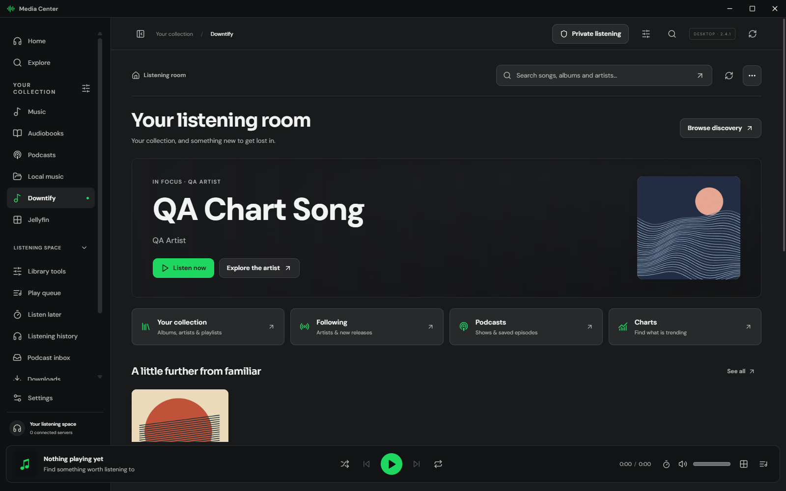

# Media Center

### Your media, together.

An open-source **Windows desktop and Android client for Navidrome, Downtify, Audiobookshelf, Jellyfin and local audio**. Browse your libraries, discover saved content, and play music, audiobooks, podcasts, films and shows through native MPV. Bring your own servers and media.

[Download Windows](https://github.com/creativekamrul/media-center/releases/latest) · [Android guide](mobile-native/README.md) · [Website](https://creativekamrul.github.io/media-center/) · [User guide](docs/USER-GUIDE.md) · [Changelog](CHANGELOG.md)

   

Media Center is an **independent, unofficial Downtify client** as well as a client for your other media servers. It is not affiliated with those projects and does not host or bundle media.

## One place to explore

Home is your daily starting point: continue listening or watching, revisit favorites and mixes, and arrange shelves around your habits. Explore brings available content together while keeping each source visible.

Desktop 2.5 adds content-grouped search with a ranked title match, artists, tracks, albums, authors/narrators, audiobooks, indexed podcast episodes, movies and shows. Artist profiles bring matching names and available discographies together across sources; author and narrator pages lead into real audiobook details. Source badges and filters remain available. Name matching never merges recordings, editions, queues or listening progress.

Central search uses **saved library content**. Unsaved music belongs in Downtify discovery, reached through an explicit action rather than silently querying external catalogs.

## A proper Downtify listening room



- Artwork-led Listening Room, saved collections, charts, artist discovery and similar-track exploration.
- In-app chart playlists with ordered/repeated songs, search, Shuffle play, Play next and an optional external-link action.
- Supported server playlist creation, ordering, sharing and imported-entry controls.
- Follow artists and playlists; browse wanted releases and inventory using your account’s permissions.
- Podcast subscriptions, retained episode files, independent episode progress and explicit retention settings.
- Server lyrics, metadata editing, replacement audio and administrator library-care tools, with confirmation for changes.
- Capability-aware modern API integration; older servers retain supported legacy behavior.

## Your sources

| Source | What you can bring | Desktop integration baseline |
| --- | --- | --- |
| Navidrome | Music, albums, artists, playlists, favorites and radio | 0.60.3 |
| Downtify | Saved music, discovery, streaming, playlists and supported management | 3.13.0, with legacy 3.9.0 checks |
| Audiobookshelf | Audiobooks, podcast shows and independently playable episodes | 2.35.1 |
| Jellyfin | Music, movies, TV libraries, seasons and episodes | 10.11.11 |
| Local folders | Tagged audio, folders, local playlists and artwork | Read-only access to selected roots |

These are tested integration baselines, not guarantees for every deployment or device. Provider-specific spaces remain available alongside combined search.

## Windows desktop

**Listen and watch.** Native MPV, output-device selection, optional exclusive audio, ReplayGain, ten-band EQ, music gapless playback and optional shared-output crossfade. Jellyfin supports original-file Direct Play with fullscreen video, audio/subtitle selection and a compact seek strip. Its playback queue remains separate.

**Follow stories.** Resume books across physical files, seek whole-book chapters, use smart rewind, speed controls, bookmarks, notes and chapter-end sleep. Podcasts retain show/episode identity, inbox filters and individual progress. Synchronization failures remain visible with local checkpoints.

**Make it yours.** Studio and Lounge listening layouts, timed/plain/custom lyrics, artwork overrides, shared fonts, palettes, interface materials and custom CSS. Pin collection views, build saved rule-based mixes, organise personal shelves and export listening Recaps.

**Keep your data.** Local SQLite settings and history, Windows-encrypted credentials, original-file offline audio controls, saved queues, personal exports and GitHub updates. Existing servers and cache are retained during ordinary updates. See the [feature inventory](docs/FEATURES.md) for detailed support and limitations.

## Audio quality: what actually plays

| Playback | What Media Center requests |
| --- | --- |
| Saved Downtify music | The original stored file, without requesting server format/bitrate transcoding. MPV decodes it locally. |
| Unsaved Downtify discovery | Downtify’s full-track stream cache. In server 3.13.0, its selector prefers `bestaudio[ext=m4a]/bestaudio/best`; the actual codec/bitrate depends on the source. |
| Local audio / supported original-file server playback | Original media through MPV; optional EQ, ReplayGain, crossfade and output settings can affect the signal. |

Discovery streaming is **not a promise of lossless, hi-res, or the highest-bitrate codec available**. Saving a lossy source as FLAC does not restore lost detail. Media Center does not add another audio encoding step to these routes. Hardware bit-perfect output requires hardware verification.

See [Downtify audio paths](docs/DOWNTIFY-AUDIO-QUALITY.md) for source references and practical limits.

## Android has its own release track

The Android app bundles MPV and has mobile portrait/landscape layouts, source connections, offline shared-folder caching and portable M3U8 exports, music/spoken controls, EQ profiles, custom lyrics/artwork and notification artwork. Desktop and Android feature sets and release versions differ. This Explore update is desktop-only.

Read the [Android guide](mobile-native/README.md) and [release gates](docs/mobile/RELEASE-GATES.md). USB-exclusive/bit-perfect output is not established; Android Auto and device handoff are outside the current scope.

## See it in use

[Open the screenshot gallery](https://creativekamrul.github.io/media-center/#screens). Screenshots use explicitly fictional collections or isolated test servers; [provenance](site/assets/README.md) lists their versions. No personal server data is published.

## Install and connect

1. Download and run the [Windows x64 installer](https://github.com/creativekamrul/media-center/releases/latest).
2. Install [MPV](https://mpv.io/installation/) separately and select `mpv.exe` in Settings. The compatibility baseline is MPV 0.38+.
3. Add a server in **Settings → Servers**: Navidrome or Jellyfin uses a server URL, username and password; Audiobookshelf uses a server URL and API key/access token. Include any reverse-proxy base path.
4. Use **Test connection**, then browse the server’s libraries. For local audio, open **Local music → Add folder**.

Your computer must be able to reach the configured server URL. Jellyfin playback does not require server transcoding; bandwidth and client codec/hardware support still determine playback performance.

The app checks for stable updates on startup. Downloading and restarting to install are explicit actions in Settings. MPV is updated separately.

## Windows desktop limitations

Windows x64 is the supported desktop target. MPV is installed separately; installers are unsigned. Jellyfin uses Direct Play only: the client must decode the original file and the connection must carry its bitrate. There is no server-transcoding fallback. Jellyfin downloads, playlist editing, Live TV and box sets are not supported. Spotify, Plex and manga support are not implemented. Full Feishin and Audiobookshelf web feature parity is not complete.

Offline progress reconciliation requires a preview and confirmation. Personal backups do not include credentials, downloaded media or server-side progress. Hardware bit-perfect output, HDR/Dolby Vision and every GPU/codec combination are not guaranteed. See the [feature inventory](docs/FEATURES.md) for the full implemented scope and remaining work.

## Data and privacy

- Saved credentials are encrypted using Electron safeStorage with Windows protection. Network requests and playback control run in the main process; credentials are not exposed to the renderer.
- SQLite stores device settings, queues, checkpoints, notes, lyric bindings and listening history. Local metadata edits do not rewrite your original files.
- Connected servers receive their relevant playback/progress requests. Optional lyrics, artwork and metadata lookups use LRCLIB, Last.fm, MusicBrainz/Cover Art Archive and Apple iTunes. Enabled Last.fm scrobbling and Discord presence share the configured activity.
- No app analytics service is configured. The website has no analytics, remote fonts or third-party scripts.

Android credentials are encrypted with Android Keystore-backed storage. Provider requests, MPV and shared-folder access stay in the Android native module. Diagnostic reports exclude server addresses, credentials and media titles. See the Android migration guide before replacing a development-signed preview.

## Desktop development

Electron, React, TypeScript, SQLite and MPV. Requires Windows, Node.js 22+, npm and the .NET 10 SDK for the native helper. Packaged users do not need .NET installed.

```powershell
git clone https://github.com/creativekamrul/media-center.git
cd media-center
npm ci
npm run build:media-controls
npm run dev
```

Select your MPV executable in the development app. Verification commands:

```powershell
npm run typecheck
npm test
npm run test:updater
npm run build
npm run test:desktop
npm run package:win
```

Set `MPV_TEST_PATH` for muted native playback tests and `MEDIA_CENTER_EXECUTABLE` for packaged-app checks. Tests use isolated fixture servers and profiles. Artifacts go to ignored `artifacts/`; installers go to ignored `release/`. Releases include corresponding source, update metadata and checksums.

## Documentation and contributions

- [User guide](docs/USER-GUIDE.md): setup, controls, backups and troubleshooting.
- [Feature inventory](docs/FEATURES.md): supported behavior and known gaps.
- [Architecture](docs/ARCHITECTURE.md) and [API contracts](docs/API-CONTRACTS.md).
- [Release process](docs/RELEASING.md) and [website deployment](docs/WEBSITE.md).
- [Contributing](CONTRIBUTING.md), [issues](https://github.com/creativekamrul/media-center/issues) and [security reporting](SECURITY.md).

Do not include credentials, databases or private library data in public reports.

## License

GPL-3.0-only. See [LICENSE](LICENSE) and [third-party notices](THIRD_PARTY_NOTICES.md). Media Center is independent of the server projects it supports. Feishin informs the music feature-parity target.
