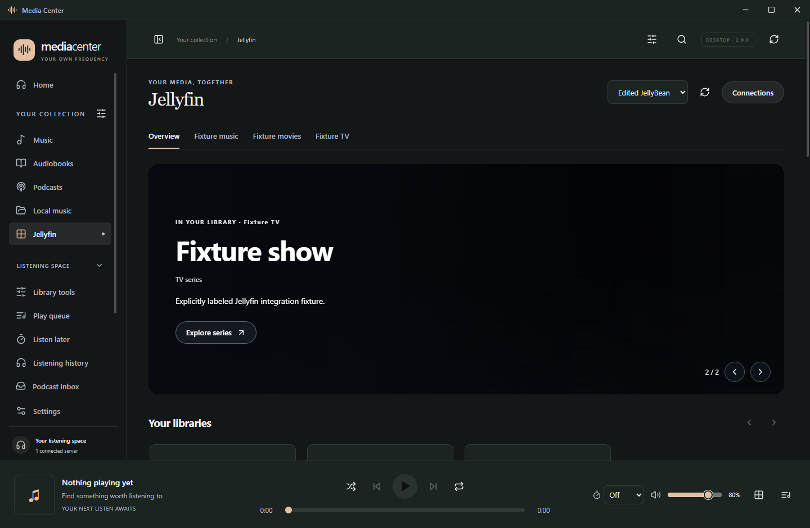

# Media Center

An open-source Windows desktop client for **Navidrome, Audiobookshelf, Jellyfin and local audio**. Play music, audiobooks, podcasts, movies and TV with native MPV. Connect existing servers; Media Center does not host or bundle media.

[Download for Windows](https://github.com/creativekamrul/media-center/releases/latest) · [Website](https://creativekamrul.github.io/media-center/) · [User guide](docs/USER-GUIDE.md) · [Changelog](CHANGELOG.md)

  

## Supported sources

| Source | Media | Compatibility baseline |
| --- | --- | --- |
| Navidrome | Music, albums, artists, playlists and radio | 0.60.3 |
| Audiobookshelf | Audiobooks and podcasts | 2.35.1 |
| Jellyfin | Music, movies and TV shows | 10.11.11 |
| Local folders | Tagged audio and folder browsing | Read-only access to selected roots |

These versions are the project’s API compatibility baselines, not a guarantee for every server configuration or hardware combination.

## Features

### Music and playlists

Browse albums, artists, songs, genres, favorites and radio. Connect multiple Navidrome servers, browse each library or combine them, and keep your selected source between visits. Create and edit playlists, preserve duplicate tracks, sort track lists and play them in the displayed order. Build saved mixes from artists, genres, years, favorites and grouped rules.

### Audiobooks and podcasts

Resume Audiobookshelf books, navigate chapters across files, adjust speed and use smart rewind or chapter-end sleep. Manage bookmarks and timestamped notes. Browse podcast shows and individual episodes, search and filter the inbox, mark listening status and use per-show preferences. Progress sync failures remain visible with local checkpoints.

### Jellyfin music, movies and TV

Browse your server’s own libraries in a dedicated Jellyfin section. View featured titles, Continue watching, seasons, episodes, cast and related titles. Play original files through embedded MPV with fullscreen overlays, five-second skips, audio/subtitle selection, chapters, language defaults and an optional next-episode countdown.

### Local audio

Add multiple folders and browse tags as albums, artists, songs and genres, or use the original folder view. Keep device-local favorites, playlists, artwork and metadata overrides. Original files are read-only; local M3U import/export is supported.

### Playback and queues

Native MPV with output-device selection, optional exclusive audio, ReplayGain, a ten-band EQ, gapless playback and optional shared-output music crossfade. Edit and save queues, use shuffle/repeat, sleep timers, media keys, volume scrolling and the always-on-top mini player. Jellyfin maintains a separate queue.

### Lyrics and appearance

Synced LRCLIB lyrics for music, manual matching, cached lyrics, LRC/TXT import and local timing edits. Classic and immersive views, animated lyric backgrounds, 14 palettes including Liquid Glass, 10 interface styles, custom fonts/colors and CSS export/import. Pin and reorder collection views.

### Home, search and history

Arrange Home sections, source shortcuts, listening continuations, Jellyfin watching shelves and recent items. Search across connected services and local music with source/type filters. Use Listen Later, personal shelves, private listening, device statistics and 12 exportable Recap layouts.

### Downloads and administration

Download original Navidrome and Audiobookshelf audio with a storage quota, status filters, pause/resume/retry and explicit offline-progress reconciliation. Edit and test saved servers, check connection health, search Settings, export personal backups and diagnostics, and install stable updates from the app. Optional Last.fm scrobbling and Discord presence are configurable.

## Screenshots



Jellyfin in v2.0.0, using explicitly labeled integration-test data. No media is bundled.

[View the screenshot gallery](https://creativekamrul.github.io/media-center/#explore) for music, books, podcasts, lyrics and settings. Some gallery screenshots are from earlier releases; [asset provenance](site/assets/README.md) lists their versions.

## Install and connect

1. Download and run the [Windows x64 installer](https://github.com/creativekamrul/media-center/releases/latest).
2. Install [MPV](https://mpv.io/installation/) separately and select `mpv.exe` in Settings. The compatibility baseline is MPV 0.38+.
3. Add a server in **Settings → Servers**: Navidrome or Jellyfin uses a server URL, username and password; Audiobookshelf uses a server URL and API key/access token. Include any reverse-proxy base path.
4. Use **Test connection**, then browse the server’s libraries. For local audio, open **Local music → Add folder**.

Your computer must be able to reach the configured server URL. Jellyfin playback does not require server transcoding; bandwidth and client codec/hardware support still determine playback performance.

The app checks for stable updates on startup. Downloading and restarting to install are explicit actions in Settings. MPV is updated separately.

## Current limitations

Windows x64 is the supported desktop target. MPV is installed separately; installers are unsigned. Jellyfin uses Direct Play only: the client must decode the original file and the connection must carry its bitrate. There is no server-transcoding fallback. Jellyfin downloads, playlist editing, Live TV and box sets are not supported. Spotify, Plex and manga support are not implemented. Full Feishin and Audiobookshelf web feature parity is not complete.

Offline progress reconciliation requires a preview and confirmation. Personal backups do not include credentials, downloaded media or server-side progress. Hardware bit-perfect output, HDR/Dolby Vision and every GPU/codec combination are not guaranteed. See the [feature inventory](docs/FEATURES.md) for the full implemented scope and remaining work.

## Data and privacy

- Saved credentials are encrypted using Electron safeStorage with Windows protection. Network requests and playback control run in the main process; credentials are not exposed to the renderer.
- SQLite stores device settings, queues, checkpoints, notes, lyric bindings and listening history. Local metadata edits do not rewrite your original files.
- Connected servers receive their relevant playback/progress requests. Optional lyrics, artwork and metadata lookups use LRCLIB, Last.fm, MusicBrainz/Cover Art Archive and Apple iTunes. Enabled Last.fm scrobbling and Discord presence share the configured activity.
- No app analytics service is configured. The website has no analytics, remote fonts or third-party scripts.

## Development

Electron, React, TypeScript, SQLite and MPV. Requires Windows, Node.js 22+, npm and the .NET 10 SDK for the native helper. Packaged users do not need .NET installed.

```powershell
git clone https://github.com/creativekamrul/media-center.git
cd media-center
npm ci
npm run build:media-controls
npm run dev
```

Select your MPV executable in the development app. Verification commands:

```powershell
npm run typecheck
npm test
npm run test:updater
npm run build
npm run test:desktop
npm run package:win
```

Set `MPV_TEST_PATH` for muted native playback tests and `MEDIA_CENTER_EXECUTABLE` for packaged-app checks. Tests use isolated fixture servers and profiles. Artifacts go to ignored `artifacts/`; installers go to ignored `release/`. Releases include corresponding source, update metadata and checksums.

## Documentation and contributions

- [User guide](docs/USER-GUIDE.md): setup, controls, backups and troubleshooting.
- [Feature inventory](docs/FEATURES.md): supported behavior and known gaps.
- [Architecture](docs/ARCHITECTURE.md) and [API contracts](docs/API-CONTRACTS.md).
- [Release process](docs/RELEASING.md) and [website deployment](docs/WEBSITE.md).
- [Contributing](CONTRIBUTING.md), [issues](https://github.com/creativekamrul/media-center/issues) and [security reporting](SECURITY.md).

Do not include credentials, databases or private library data in public reports.

## License

GPL-3.0-only. See [LICENSE](LICENSE) and [third-party notices](THIRD_PARTY_NOTICES.md). Media Center is independent of the server projects it supports. Feishin informs the music feature-parity target.
