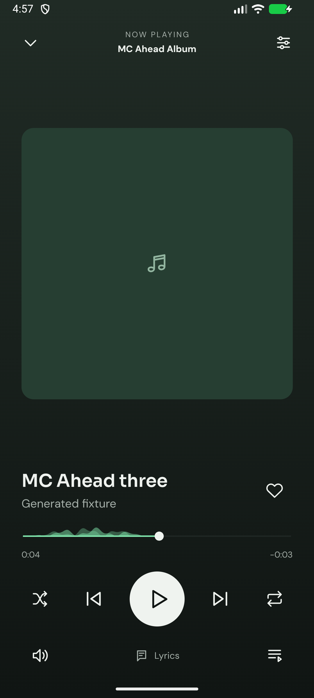

# Media Center for Android

Android-first React Native / Expo app with bundled DM Sans and Sora. The approved mobile design is retained. Portrait and adaptive landscape layouts are supported; landscape Now Playing uses artwork and controls side by side.

## Current implementation

- Navidrome, Downtify, Audiobookshelf and Jellyfin connections, with encrypted native credential storage and independently identified content.
- Bundled MPV playback, Android media-session controls, acknowledged graphic/parametric EQ, tonal/custom presets, manual output profiles, ReplayGain, optional music gapless/crossfade, sleep timers and separate music/book/episode queues.
- Native notification and media-session album artwork, loaded outside the UI thread through the persistent thumbnail cache.
- Cross-provider browsing/search, Home shelves, Explore mixes, pinned collections, app playlists and configurable Library shortcuts.
- Cache original audio/video to a selected shared folder, export relative M3U8 playlists, explicitly link legacy exports, apply storage/network/charging rules, recover owned interrupted files and verify originals without deleting changed files.
- Password-encrypted native personal-data migration with read-only verification and fresh-install restore. Media/cache catalogs and Android grants stay device-specific; see [migration guide](../docs/mobile/BACKUP-MIGRATION.md).
- Adaptive app icon, themed monochrome icon, native splash, loading placeholders and a first-run guide.

[Download Android 1.0.0](https://github.com/creativekamrul/media-center/releases/tag/mobile-v1.0.0). Android 8.0+ and ARM64 are supported. Feature implementation is not equivalent to verification of every device combination. See `../docs/mobile/EXPANSION-PLAN.md` and `../docs/mobile/RELEASE-GATES.md` for incomplete capabilities and acceptance checks. USB-exclusive and bit-perfect output are not established. Android Auto and device handoff are outside the current release scope. Additional widget work is not requested.

## Build and test

Install a compatible Android SDK and JDK (Android Studio's bundled JBR works), then run `npm ci`, `npm run typecheck`, `npm run lint` and `npm test` here.

Use `powershell -NoProfile -ExecutionPolicy Bypass -File scripts/build-local.ps1 -RegenerateNative` for a self-contained local phone preview. Add `-Emulator` for the ARM64-translated emulator packaging variant. APKs and SHA256 sidecars are copied into ignored `../release/mobile/`. Regenerate native configuration when app.json, native dependencies or config plugins change. Do not edit generated android/ files by hand.

Native compiler concurrency is bounded to avoid exhausting Windows' paging file. `scripts/prepare-mpv.ps1` verifies the pinned MPV dependency checksum. The project uses MPV's shared C++ runtime consistently across native modules. Local builds also run fail-closed Android native lint, including API compatibility checks.

`-Production` requires `MEDIA_CENTER_KEYSTORE`, `MEDIA_CENTER_STORE_PASSWORD`, `MEDIA_CENTER_KEY_ALIAS` and `MEDIA_CENTER_KEY_PASSWORD` in the build environment. Missing signing configuration fails the production build. This does not publish anything. The permanent signing key is backed up in Bitwarden; see `../docs/mobile/SIGNING.md` for recovery. Production signing and verification remain required before public distribution; a preview signed with the development key cannot silently migrate to a different production certificate.

## Native boundary

The Android module owns credentials, authenticated provider requests, cache file access and MPV state. The UI receives sanitized metadata and cached artwork file URIs. Authenticated URLs and tokens are not exported to portable playlists or system artwork metadata. Books and podcast episodes keep distinct target and progress identities.

`tests/migration-native.ps1` runs isolated backup/transfer/audio/artwork/fallback acceptance against the dedicated QA AVD and a separate test UID. `tests/service-lifecycle.py` checks the real Android download-service restart using the documented local throttled Postman fixture. Neither script may run against the user’s phone or clear the main app’s data.

`tests/device-smoke.py` contains an explicitly named disposable loopback fixture. Live-server tests must not write playlists or alter server records without a test case requiring it. Never clear the user's app data to install a new preview.

## License

GPL-3.0-only. Public releases must include the project source and notices/source references for bundled native dependencies and fonts. A JavaScript export is not an installable Android app.

## Release acceptance tools

The guarded QA scripts `tests/updater-native.py`, `tests/native-transitions.py` and `tests/large-transfer.py` exercise native APK verification/installer behavior, real MPV music transitions/continuation and prolonged bounded-memory downloads in a separate test UID. They require the explicitly named QA AVD and the documented generated Postman fixture. Never use them on a phone or a real user profile.

`python scripts/package-app-sources.py` collects current source and locked build metadata. Pair it with the pinned native-source and third-party notice archives for distribution. Generated archives and verification reports stay under ignored `release/` and `artifacts/`.

## Signed build screenshot

Captured from the permanently signed 1.0.0 emulator build. Titles, audio and account are generated QA fixtures; no personal library data or bundled music is shown.
